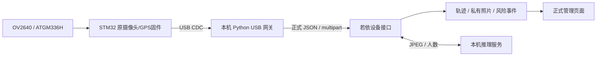

# RiderGuard 正式协议与本机硬件联调

更新：2026-11-03。当前只在本机运行，不部署服务器，不恢复旧的 4G 演示上传任务。

## 1. 当前入口

在项目根目录双击 `start_riderguard.bat`。启动器准备本机 MySQL、Redis、正式若依后端、推理服务、管理前端及 USB 网关依赖，并把应用进程日志保存在 `deploy/local-runtime/`。服务就绪后打开 `http://127.0.0.1/`。

前往 **骑手安全 → 骑手与设备** 创建设备、绑定骑手，保存只展示一次的设备凭证。再在 **规则与运维 → 本机设备接入** 中：

1. 用 USB 数据线连接 STM32，点击“扫描”选择它对应的 COM 端口。
2. 选择同一设备编号，粘贴该设备凭证，点击“开始 USB 测试”。
3. 查看定位状态、GPS 速度和后台限速响应。室内无定位时保留无效状态，不生成假坐标。
4. 点击“上传一张照片”验证图片和推理链路，或明确开启“自动传图”。每次开始连接时自动传图默认关闭。
5. 点击“查看地图与轨迹”或“查看摄像头”进入正式业务页面。
6. 结束后点击“停止并释放串口”。停止整个本机应用可双击根目录 `stop_riderguard.bat`，数据库服务和已保存的数据会保留。

开始/停止由已登录的超级管理员或骑手管理角色操作；只读角色不具备本机串口控制能力。设备凭证只经本机请求及子进程环境传递，不写入启动参数或连接记录；页面开始连接后会清空输入框。

## 2. 本机数据路径

USB 网关只读取 STM32 原有 USB 输出：`GPS_NMEA $...` 和 `JPEG_TX_BEGIN LEN=...` 加二进制 JPEG。它不向 USART3 或 4G 模块发送 AT 命令，也不自动烧录固件。

串口接收与定位、照片 HTTP 上传分线程运行。JPEG 按声明长度拆包，图像中的换行或 `GPS_NMEA` 字样不会被误当成文本。定位队列有上限，失败时保留原采样编号重试；图片超过 15 秒丢弃，避免旧图片改变实时风险状态。USB 网关当前只做有界内存缓冲，进程退出不承诺离线数据持久化。

## 3. 正式协议

- 定位：`POST /device/riderguard/telemetry`，JSON。
- 图片：`POST /device/riderguard/image`，multipart 字段 `deviceId`、`sampleId`、`capturedAtMs`、`image`。
- 两种请求都使用 `X-Device-Token`；公网场景必须 HTTPS，本机回环联调可用 HTTP。
- `capturedAtMs` 为可信 Unix 毫秒时间。本机 USB 网关使用 Windows 采集时间，不能改成 STM32 的 `HAL_GetTick()`。
- 同一设备的 `sampleId` 唯一，重试保持原值。网关编号包含随机启动标识，避免程序重启后计数碰撞。
- 无有效 GPS 时 `gpsValid=false`，经纬度为 `null`；GPS 速度在网页显示为不可用，传输层按现有正式协议发送数值 0。
- 当前正式协议处理 GNSS。LBS 粗定位、IMU 风险数据和电量尚未完整纳入正式业务字段，不能将它们标成有效 GPS 或已实现的风险判断。

字段约束见 `shared/schemas/riderguard-telemetry-v1.schema.json`。

MCU 侧可复用的无 HAL 协议模块已放在 `device/firmware/protocol/`：`rg_gps` 解析校验过的 RMC，`rg_telemetry` 生成正式 JSON。它们不包含设备凭证，不自动启动联网。

## 4. 统一采样与时效

| 参数 | 默认值 | 设置方式 |
| --- | --- | --- |
| 定位上报目标 | 3000 ms | `RIDERGUARD_TELEMETRY_INTERVAL_MS` |
| 自动图片间隔 | 30000 ms | `RIDERGUARD_IMAGE_INTERVAL_MS` |
| 最近视觉结果显示有效期 | 90000 ms | `RIDERGUARD_VISION_STALE_AFTER_MS` |
| 单张图片参与实时判定的采集年龄 | 不超过 15 秒 | `RiderGuardFramePolicy` |
| 管理网页数据轮询 | 约 3 秒 | 只更新发生变化的数据与图片 |

图片采样间隔与单张图片的传输年龄是两个指标。30 秒一次图片不代表可以把采集了很久的旧照片当成现场实时状态。视觉显示有效期至少覆盖两个图片间隔；不合法的启动配置会被拒绝。

设备定位响应包含 `mode`、`limitKph`、`validUntilMs`、`visionStatus`、`imageIntervalMs`、`telemetryIntervalMs`、`visionStaleAfterMs`。网关采用后台返回的采样间隔并在网页显示当前策略。蜂鸣器/状态灯独立 C 适配模块尚需接入实际 GPIO 回调，USB 网关显示策略并不等于已经驱动硬件提醒。

## 5. 本机启动与停止

启动器会创建 `device/gateway/.venv/`，只安装锁定的 `pyserial==3.5`。运行时、设备凭证、模型权重、数据库及日志均不应提交到 Git。

应用绑定本机回环地址。USB 测试功能默认关闭，仅本机启动器为本次后端进程设置 `RIDERGUARD_LOCAL_TEST_ENABLED=true`；公网部署不应启用它。网关只允许合法 COM 端口、登记设备和正确凭证，网页不能提供任意程序或脚本路径。

启动器检测后端源文件指纹，代码改变时重建它启动并记录的后台进程。它不关闭其他项目的服务；若端口被未知进程占用，会报出端口冲突。新启动的应用在后台运行，日志见 `backend-stdout.log`、`backend-stderr.log`、`frontend-stdout.log`、`frontend-stderr.log`、`ai-stdout.log`、`ai-stderr.log`。

本机默认推理模式仍为 `mock`，网页会显示该模式。模拟识别链路通过不代表真实模型效果通过。要使用真实 YOLO，先准备并验证模型权重，再在启动前设置 `RIDERGUARD_INFERENCE_MODE=yolo` 和 `RIDERGUARD_MODEL_PATH`；模型运行及相机视角要单独实测。

## 6. 4G 后续接入边界

当前本机方式可直接验证正式后台的设备、骑手绑定、定位、照片、推理状态、策略返回与事件记录。它验证的是 **USB → 正式协议**，不会消耗板上 SIM 流量。

独立 4G 设备不能访问电脑的 `127.0.0.1`。后续有明确公网 HTTPS 入口后，再把板端 4G 传输实现接到相同 JSON/multipart 协议，补齐凭证配置、时钟同步、响应解析和本地提醒执行。原来 `Connectivity/LiveDashboard` 的独立演示协议不能只改 URL 就当成正式接入。

本次未迁移旧服务器地址、未部署远端服务，也未改写开发板 Flash。现有底板/接线和移动电源方案保持不变。

## 7. 回归检查

- USB 协议与 HTTP：`python -m unittest discover -s device/gateway -p "test_*.py" -v`。
- Java：Maven 运行 `RiderGuard*Test`，覆盖图片时效、保留策略、采样配置及 USB 默认禁用。
- 前端：在 `admin/ruoyi/frontend` 构建管理页面。
- 完整接口烟测沿用 `scripts/smoke_riderguard.py`；它只应连接指定的本机测试服务，并清理自己创建的临时设备和图片。

实物串口、室外 GPS、真实图片质量与模型识别结果仍需在连接设备后由上述网页逐项验收。
