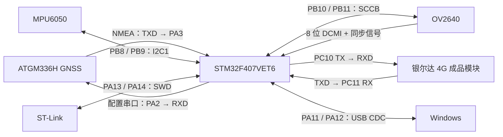

# 骑手安全守护系统：现有接线与首版 PCB 设计依据

更新日期：2026-10-29（北京时间）
工程目录：`G:\STM32\STM32Projects\F407_LED_Test`
主控：STM32F407VET6，工程配置为 LQFP100。

已确定主电源方案：**移动电源的 5V USB 输出**。用户确认当前开发板与 4G 等模块直接连接时，各模块功能均可正常使用；原型阶段保留已跑通的接线。

## 1. 当前状态与本文件用途

现有系统已经验证过：OV2640 拍摄 JPEG、外置 ATGM336H 卫星定位及测速、STM32 经 4G 将数据发到服务器，再由 Windows 网页显示。GPS 室外曾取得有效定位；LBS 基站粗定位也曾成功。它们是不同的位置来源。

**本次已暂停联网测试：**

- 已恢复并校验测试前的完整 STM32 Flash 备份，板端不再运行 `Live_Task` / `Live_Frame` 蜂窝上传任务。
- Windows 本机 `127.0.0.1:18770` 网页转发进程已停止。
- 服务器本次专用接收进程及 nginx 测试入口已暂停，源文件、图片和记录保留。
- 恢复后 USB 仍可收到摄像头帧和 GPS NMEA；检查期间未收到 `[LIVE]` 上传日志，服务器最后上报也没有继续变化。

上述措施停止了本次定位、状态、图片上传业务。**4G 模块的 VIN 并未被软件切断，当前也没有确认它进入飞行模式或关机。** 当前四线连接没有独立电源控制脚；如果需要保证模块完全不联网，应在断电状态下断开其供电，或在新 PCB 中增加可控制的电源开关。不能把“关闭网页”当成“关闭板端上传”。

本文件是现有原型的接线记录和绘制原理图的输入，不是已经审定的生产原理图。GPIO 名称表示 MCU 信号端点，**不代表开发板排针序号或模块连接器针号**。实际排针顺序、焊盘编号、封装方向还需结合对应实物和原厂封装确认。

### 证据分级

| 标记 | 含义 |
| --- | --- |
| A：用户确认且链路实测 | 已有用户接线说明，并已通过实际通信验证信号链路 |
| B：固件配置且功能实测 | 从实际运行固件核对，相关功能已运行；不等于逐根做过实物导通测量 |
| C：仅工程配置 | 代码中存在接口，尚不能据此认定实物已接齐或所有功能已验证 |
| 待核对 | 缺少该块载板原理图、完整型号或实测电压，不能作为定版数值 |

## 2. 模块与接口总览

| 部件 | 当前识别 / 工程配置 | 接口 | 确认程度 |
| --- | --- | --- | --- |
| MCU | STM32F407VET6，LQFP100 | 主控 | 芯片识别、工程配置和烧录验证 |
| 4G 成品模块 | 用户称银尔达 Cat.1 / DTU、屏蔽罩标识 Y100E；串口曾识别为 AirM2M 780EPM、V2007 LTE AT 固件 | USART3，115200 8N1 | A；完整载板型号及电气规格待核对 |
| GNSS | 工程使用 ATGM336H，具体后缀和载板版本待核对 | USART2，9600 8N1，NMEA | B；室外有效定位和速度字段已见到 |
| 摄像头 | OV2640，已收到真实 320×240 JPEG | SCCB / I2C2 + 8 位 DCMI | B |
| IMU | MPU6050 驱动及初始化代码 | I2C1，100 kHz | C；完整传感器数据、安装方向与校准仍需验证 |
| USB | STM32 原生 USB FS CDC，当前电脑枚举为 COM3 | PA11 / PA12 | B；COM 号会随电脑变化 |
| 调试器 | ST-Link V2，SWD | PA13 / PA14 | 烧录、校验已验证 |

Y100E 的产品标识与 AT 返回的芯片/固件标识应同时留在采购记录中；不能只凭屏蔽罩文字确定载板输入电压、排针尺寸或 UART 电平。本系统的卫星定位来自外置 ATGM336H，不应把 4G 的 LBS 查询当成 GPS。



## 3. 4G 模块：四根已确认的线

方向以下列 STM32 端命名为准。UART 必须 TX 接对端 RX。

| 4G 模块端 | STM32 / 电源端 | 建议网络名 | 说明 | 证据 |
| --- | --- | --- | --- | --- |
| VIN | 开发板 5V 排针 | `CELL_VIN` | 这是用户确认的原型接法；没有据此测得 VIN 电压或确认载板允许范围 | A / 供电规格待核对 |
| GND | STM32 GND，同时接电源负极 | `GND` | 全系统共地 | A |
| RXD | PC10，USART3_TX，AF7 | `MCU_CELL_TX` | MCU → 4G，115200 8N1 | A |
| TXD | PC11，USART3_RX，AF7 | `MCU_CELL_RX` | 4G → MCU，115200 8N1 | A |

当前没有使用 RTS / CTS 硬件流控。模块侧 RXD / TXD 是成品载板端口名称；尚未追踪到裸 Air780EPM 的焊盘编号。

### 4G 的供电与电平必须分开核实

- `VIN 接 5V` 说的是成品载板输入，不能据此把裸模组 VBAT 或 UART 也接到 5V。
- Air780EPM 的 IO 电源域会受版本、配置和载板电路影响。当前直连能够通信，并不代替载板电平规格与实测；绘图前核对 RXD / TXD 高电平及输入容限。
- 当前接线记录不能证明 5V 排针具有足够的发射瞬态电流能力。曾出现过 SIM 识别不稳定；供电波动只是待排查因素，尚未确诊。
- 以最终选定的完整模块规格决定稳压器、峰值电流裕量、输入保护及就近储能电容，并在真实上传过程中测量模块端电压。供电参考见[合宙 Air780EPM 硬件资料入口](https://docs.openluat.com/air780epm/)。

**首版建议：**若复用现有银尔达成品模块，先按它的 VIN 和接口规格设计底板；若改用裸 Air780EPM，则重新设计其电源、开机/复位、SIM、USB 下载、天线与电平接口，不能把当前四针插座直接当成裸模组电路。

## 4. GNSS / GPS 模块

| GNSS 模块端 | STM32 端 | 建议网络名 | 方向 / 用途 | 证据 |
| --- | --- | --- | --- | --- |
| TXD | PA3，USART2_RX，AF7 | `GNSS_TX_TO_MCU` | GNSS → MCU，接收 NMEA | B |
| RXD | PA2，USART2_TX，AF7 | `MCU_TX_TO_GNSS` | MCU → GNSS，保留配置能力；本轮定位主要使用接收数据 | B / 实物 RX 线待逐根核对 |
| GND | STM32 GND | `GND` | 共地 | 必需 |
| VCC / VIN | **具体供电端待核对** | `GNSS_SUPPLY` | 按完整载板规格决定；不能仅凭 ATGM336H 名称认定可输入 5V | 待核对 |
| PPS（若有） | 当前未分配 GPIO | `GNSS_PPS`（可选） | 当前定位与测速不依赖 PPS | 未使用 |
| 天线 | GNSS 天线接口 | 按模块接口定义 | 有源/无源天线、馈电和连接器规格待核对 | 待核对 |

当前串口为 9600、8 数据位、无校验、1 停止位，约每秒可收到 GNSS 数据。定位采用有效 RMC；测速使用 RMC 对地速度，按 `km/h = 节 × 1.852` 换算，不需要新增轮速输入脚。

新 PCB 应给 GNSS 使用干净、稳定的电源分支，天线远离 4G 天线、开关电源和摄像头时钟区域。若保留备用电源、天线馈电或 PPS，按所选模块的完整手册设计。当前并未确认这些辅助脚的实物接法。

## 5. OV2640 摄像头

### 5.1 数据、同步与控制线

| 摄像头模块信号 | STM32 引脚 | 外设 / 模式 | 方向（相对 MCU） |
| --- | --- | --- | --- |
| D0 | PC6 | DCMI_D0，AF13 | 输入 |
| D1 | PC7 | DCMI_D1，AF13 | 输入 |
| D2 | PE0 | DCMI_D2，AF13 | 输入 |
| D3 | PE1 | DCMI_D3，AF13 | 输入 |
| D4 | PE4 | DCMI_D4，AF13 | 输入 |
| D5 | PB6 | DCMI_D5，AF13 | 输入 |
| D6 | PE5 | DCMI_D6，AF13 | 输入 |
| D7 | PE6 | DCMI_D7，AF13 | 输入 |
| PCLK | PA6 | DCMI_PIXCLK，AF13 | 输入 |
| HREF / HSYNC | PA4 | DCMI_HSYNC，AF13 | 输入；以该模块丝印/图纸确认名称 |
| VSYNC | PB7 | DCMI_VSYNC，AF13 | 输入；当前实测固件使用低有效 |
| SIOC / SCL | PB10 | I2C2_SCL，AF4 | MCU 发起控制 |
| SIOD / SDA | PB11 | I2C2_SDA，AF4 | 双向控制数据 |
| RESET / RST | PB0 | GPIO 推挽输出 | 低脉冲复位，随后拉高 |
| PWDN | PB1 | GPIO 推挽输出 | 当前工作状态拉低 |
| GND | STM32 GND | 电源地 | 共地 |
| VCC / VIN | **具体接入电源待核对** | 按摄像头载板规格 | 不能把载板输入与裸传感器电源混为一谈 |
| XCLK / MCLK | **当前工程没有配置 MCU 输出此时钟** | 来源待核对 | 需确认现有摄像头载板是否自带振荡器 |

上表信号映射来自运行代码，并有真实 JPEG 图像作为功能验证。**摄像头连接器的针数、间距、1 脚方向和实际排列尚未建立实物导通表。** 若模块丝印采用 Y2～Y9 等名称，应先按其手册与 D0～D7 对应，不能凭名称或照片直接套封装。

### 5.2 当前工作参数

| 项目 | 当前工作代码 |
| --- | --- |
| 输出 | JPEG，QVGA 320×240 |
| 总线 | 8 位 DCMI，硬件同步，JPEG 模式 |
| 像素采样 | PCLK 上升沿 |
| HSYNC / VSYNC 极性 | `DCMI_HSPOLARITY_LOW` / `DCMI_VSPOLARITY_LOW` |
| 控制总线 | I2C2 / SCCB，50 kHz；驱动使用 7 位地址 0x30 |
| DMA | DMA2 Stream1，Channel1 |
| 图片上传上限 | 当前测试固件 65536 字节，已验证 QVGA JPEG；未验证连续视频流 |

复用当前固件时保留上述引脚和已验证的极性设置。新的摄像头载板若没有独立时钟源，就必须补充 XCLK 设计及相应固件；不能直接把未配置的 PA8 画成已有摄像头时钟线。

## 6. MPU6050

| MPU6050 模块端 | STM32 / 其他端 | 建议网络名 | 当前结论 |
| --- | --- | --- | --- |
| SCL | PB8，I2C1_SCL，AF4 | `IMU_SCL` | 固件配置，100 kHz |
| SDA | PB9，I2C1_SDA，AF4 | `IMU_SDA` | 固件配置 |
| GND | STM32 GND | `GND` | 必需共地 |
| VCC / VIN | 按载板规格，实际接法待核对 | `IMU_SUPPLY` | 绘图前确认稳压与上拉电压 |
| AD0 | 配置为低，或确认载板已有对应下拉 | `IMU_AD0` | 当前驱动访问 7 位地址 0x68；实物绑定位待核对 |
| INT | 当前没有分配 MCU GPIO | `IMU_INT`（预留） | 当前驱动未使用中断线 |
| XDA / XCL（若有） | 当前未使用 | 不分配主控网络 | 辅助接口，不等于主 I2C 的 SDA / SCL |

I2C1 的 SCL / SDA 需要合适的外部上拉；先核对载板已有电阻，再确定主板是否装配，避免重复上拉过强或拉到错误电压。固件初始化了 IMU，但尚未完成本次骑手姿态/跌倒功能、安装方向和校准验证。

## 7. ST-Link、USB、LED 与时钟

### 7.1 SWD 下载口

| 调试信号 | STM32 端 | 设计说明 |
| --- | --- | --- |
| SWDIO | PA13 | 必须保留 |
| SWCLK | PA14 | 必须保留 |
| GND | GND | 与目标板共地 |
| VTref / VAPP（若调试器提供） | 目标板 3.3V 电源域 | 用于目标电平参考，不能默认是电源输出 |
| NRST | MCU NRST | 建议引出，便于复位和连接恢复；现有 NRST 线是否实际接上待核对 |
| SWO（可选） | PB3 | 当前未使用，按调试需求预留 |

用户曾确认使用 ST-Link 的 3.3V 脚给开发板 3.3V 供电，同时 4G VIN 接开发板 5V 排针。**该接法不表示 3.3V 会自动升压为 5V。** 本轮没有测量 5V 排针的来源、负载电压和供电能力。

ST-Link 不应作为成品系统的主电源。不同小型 ST-Link 的 3.3V 输出与原厂调试器 VTref 引脚定义可能不同，须按实际设备丝印和说明核对。[原厂 ST-Link/V2 手册](https://www.st.com/resource/en/user_manual/um1075-stlinkv2-incircuit-debuggerprogrammer-for-stm8-and-stm32-stmicroelectronics.pdf)将 VAPP 定义为目标板电源参考。

### 7.2 原生 USB 与其他已占用引脚

| 信号 | STM32 引脚 | 说明 |
| --- | --- | --- |
| USB D− | PA11，AF10 | USB OTG FS Device / CDC |
| USB D+ | PA12，AF10 | USB OTG FS Device / CDC |
| USB GND | GND | USB 与主板共地 |
| USB VBUS | 电源输入/检测按主板电源方案设计 | 当前固件关闭 VBUS sensing；不能据此省略供电及反灌设计 |
| 板载 LED | PA1 | GPIO 输出；LED 实物极性与限流电阻需查开发板图纸 |
| 外部主晶振输入 | PH0 / OSC_IN | 当前 HSE 配置 8 MHz |
| 外部主晶振输出 | PH1 / OSC_OUT | 与选定晶体、负载电容配套设计 |

当前时钟为 HSE 8 MHz、SYSCLK 168 MHz、USB 48 MHz。ST-Link 的 USB 与 MCU 原生 USB 是两个接口；UART2 / UART3 也不是 USB 数据线。

## 8. MCU 引脚占用汇总与冲突

| 引脚组 | 当前用途 |
| --- | --- |
| PA1 | LED |
| PA2 / PA3 | GNSS USART2_TX / RX |
| PA4 / PA6 | 摄像头 HSYNC / PCLK |
| PA11 / PA12 | 原生 USB D− / D+ |
| PA13 / PA14 | SWDIO / SWCLK |
| PB0 / PB1 | 摄像头 RESET / PWDN |
| PB6 / PB7 | 摄像头 D5 / VSYNC |
| PB8 / PB9 | MPU6050 I2C1 SCL / SDA |
| PB10 / PB11 | 摄像头 I2C2 SCL / SDA |
| PC6 / PC7 | 摄像头 D0 / D1 |
| PC10 / PC11 | 4G USART3_TX / RX |
| PE0 / PE1 / PE4 / PE5 / PE6 | 摄像头 D2 / D3 / D4 / D6 / D7 |
| PH0 / PH1 | HSE 主晶振 |

这份分配没有给两个功能分配同一个 GPIO。后续扩展时关注：

- PB6 / PB7 已分配给摄像头，IMU 的 I2C1 保持使用 PB8 / PB9。
- PB10 / PB11 已分配给摄像头控制总线，4G 的 USART3 保持使用 PC10 / PC11。
- PC6 / PC7 已分配给摄像头，不应同时启用其 USART6 复用。
- MCU 具备某个引脚的其他复用功能，并不代表可以与当前用途同时使用。

MCU GPIO、复用功能及最终 LQFP100 焊盘编号，按 [ST DS8626 数据手册](https://www.st.com/resource/en/datasheet/stm32f407ve.pdf)核对。这里没有填写尚未逐项校验的封装焊盘号，避免把开发板排针位置与芯片焊盘混用。

## 9. 固件与 CubeMX 配置不一致处

| 项目 | `.ioc` 当前内容 | 已实测工作代码 | 处理要求 |
| --- | --- | --- | --- |
| DCMI HSYNC / VSYNC 极性 | HIGH / HIGH | LOW / LOW | 先统一设置，再生成代码，避免覆盖已验证配置 |
| 4G USART3 | 未列入 `.ioc` 外设/引脚清单 | 联调固件在 PC10 / PC11 初始化 USART3，115200 | 恢复联网功能时将配置正式纳入工程 |
| GNSS USART2 | PA2 / PA3，9600 | 与代码一致 | 保留 |
| 摄像头 XCLK | 未配置 MCU 时钟输出 | 未配置 MCU 时钟输出 | 查清摄像头载板时钟来源 |

正式板所用生产固件还需明确“上电默认联网还是默认待机”。本次测试程序属于隔离联调固件，不应直接当成量产启动策略。

## 10. 供电与 PCB 设计输入

### 10.1 电源分配

#### 当前原型采用的方案

按用户选择，采用移动电源，保留现有开发板及模块接线：


- 4G 的 GND、PC10 / PC11 串口线保持当前接法，全系统共地。
- GPS、摄像头、MPU6050 的供电与信号线保持已经跑通的接法。
- 当前方案共用一个移动电源，无需为了原型验证另加一套 4G 电源。
- 移动电源按 5V USB 输出使用；额定输出电流、线缆压降和开发板 USB→5V 排针路径承载能力需在整机负载下核对，容量 mAh 与瞬态供电能力是不同指标。
- 使用移动电源作主电源时，ST-Link 负责 SWD 调试；其电源输出不与主板电源直接并联，VTref 则按调试器要求接目标电平参考。

现有系统正常工作是有效的原型验证结果。PCB 定版前，再测 4G 上传时 VIN 电压及供电路径压降，并据此决定新板的走线、电源分支和储能配置。后续若增加休眠功能，再验证所选移动电源能否在低负载时持续供电。

#### 后续 PCB 的功能分支

绘制新 PCB 时可按以下功能分配电源，具体电压/电流数值在选定模块后填写：

| 分支 | 负载 | 需要确认的设计输入 |
| --- | --- | --- |
| 主输入 | 全系统 | 已选移动电源 5V USB 输出；核对端口额定电流、线缆和接口保护；原型不另做锂电池充电电路 |
| MCU 电源 | STM32 及相应逻辑 | 3.3V 稳压与去耦 |
| 4G 供电路径 | 选定的成品载板或裸模组 | 原型沿用开发板 5V→现有载板 VIN；新板按模块输入范围、峰值电流、压降和散热设计 |
| GNSS 电源 | 定位模块及可能的有源天线 | 载板输入范围、噪声、天线馈电方式及备用电源 |
| 摄像头电源 | 摄像头载板 | 输入范围、内部稳压、启动与时钟来源 |
| IMU 电源 | MPU6050 载板 | 电源及 I2C 上拉域、载板已有电阻 |

新 PCB 可将 4G 大电流分支与 GNSS/MCU 分支分别布置和去耦，保持共地及连续回流路径。建议预留 4G 电源开关/负载开关和测试点，使软件可真正停用模块，并处理 UART 向断电模块反向供电的问题。开关额定能力依据模块峰值电流选定。这是新板设计建议，原型阶段继续使用现有接线。

### 10.2 STM32 最小系统

若直接把 STM32 芯片放上新板，需要补齐开发板目前已经提供的电路：全部电源/地引脚、模拟电源与参考电压、去耦、VCAP、NRST、BOOT、HSE、SWD 及 USB 电源路径。

按 [ST AN4488 硬件设计指南](https://www.st.com/resource/en/application_note/an4488-getting-started-with-stm32f4xxxx-mcu-hardware-development-stmicroelectronics.pdf)绘制：每个 VDD 就近去耦；正常内部稳压模式下 VCAP1 / VCAP2 分别按手册接合适的低 ESR 电容，不能接成外设 3.3V 供电；BOOT0 给出确定默认电平，保留复位和下载入口。晶体负载电容根据所选晶体计算，不能仅从“8 MHz”推定固定电容值。

### 10.3 布线与接口

- 摄像头并行数据和 PCLK 走线紧凑、参考地连续，连接器方向清晰，预留调试位置。
- USB 按差分对要求布线，接口旁考虑 ESD 和电源保护；若选择 USB-C，补齐对应角色的 CC 电路。
- 4G 与 GNSS 天线按各自天线/模组参考设计布置，明确净空、连接器和安装方向。
- 连接器丝印写出 VIN、GND、TXD、RXD 的所属端；每个接口标 1 脚，电源接口做防反接设计。
- 预留 `MCU_3V3`、`CELL_VIN`、`GND`、4G TX/RX、GNSS TX/RX、NRST 和 SWD 测试点。

## 11. 发给 PCB 设计人员前需补齐的实物信息

| 待确认项 | 为什么需要 |
| --- | --- |
| STM32 开发板完整型号/原理图，是否继续复用最小系统板 | 决定是画底板插座还是重建 MCU 最小系统 |
| 银尔达 4G 载板完整型号、正反面丝印、尺寸和原理图 | 确定 VIN、UART 电平、接口针序、固定孔与天线位置 |
| GNSS 的完整后缀/载板型号、天线类型和供电接法 | 确定供电、天线馈电、备份电源与接口针序 |
| OV2640 载板型号、连接器针序、VCC 规格和 XCLK 来源 | 防止电源、数据位顺序、连接器镜像及漏接时钟 |
| MPU6050 载板、AD0、上拉电阻及实际接线 | 确认地址、电平及传感器安装方向 |
| 所选移动电源的 5V 输出能力与整机同时工作峰值电流 | 主电源类型已确定；补齐额定电流和实测负载，决定接口、保护、储能、铜宽与散热 |
| 逐根导通表和连接器 1 脚照片/图纸 | 把 MCU 逻辑信号映射落实到实际连接器焊盘 |

补齐后再形成原理图网络表、BOM、连接器封装与尺寸图，进行电源和引脚复核。现有接口分配可以作为第一版基础；供电规格、连接器针序及摄像头时钟仍是必须落实的输入。

## 12. 本地证据与后续恢复测试

### 工程证据

| 文件 | 可核对内容 |
| --- | --- |
| [main.h](G:/STM32/STM32Projects/F407_LED_Test/Core/Inc/main.h) | LED、摄像头 RESET / PWDN 定义 |
| [stm32f4xx_hal_msp.c](G:/STM32/STM32Projects/F407_LED_Test/Core/Src/stm32f4xx_hal_msp.c) | DCMI、I2C1、I2C2、USART2 的实际 GPIO 复用 |
| [main.c](G:/STM32/STM32Projects/F407_LED_Test/Core/Src/main.c) | 相机同步极性、总线速率、时钟与模块初始化 |
| [gnss.h](G:/STM32/STM32Projects/F407_LED_Test/Core/Inc/gnss.h) | GNSS TX→PA3、RX→PA2 接线注释 |
| [ov2640.c](G:/STM32/STM32Projects/F407_LED_Test/Core/Src/ov2640.c) | SCCB 地址、PB7 VSYNC、复位及 JPEG 配置 |
| [live_modem.c](G:/STM32/STM32Projects/F407_LED_Test/Connectivity/LiveDashboard/firmware/live_modem.c) | 测试时的 PC10 / PC11 USART3、4G 上传逻辑；目前未在板上运行 |
| [F407_LED_Test.ioc](G:/STM32/STM32Projects/F407_LED_Test/F407_LED_Test.ioc) | CubeMX 配置；上述两处差异尚未修改 |
| [paused-original-runtime.json](G:/STM32/STM32Projects/F407_LED_Test/Connectivity/LiveDashboard/paused-original-runtime.json) | 恢复后摄像头/GPS USB 输出及无 LIVE 日志的检查 |
| [test-paused.json](G:/STM32/STM32Projects/F407_LED_Test/Connectivity/LiveDashboard/test-paused.json) | 接收服务、专用入口暂停及无新上传的确认 |
| [stop-upload-restore.log](G:/STM32/STM32Projects/F407_LED_Test/Connectivity/LiveDashboard/stop-upload-restore.log) | 完整 Flash 恢复与写入校验结果 |

完整原固件备份：`Diagnostics/Backups/STM32F407_flash_before_DTU_20261028_165139.bin`，524288 字节，SHA256：

```text
825CE0A8D94390AB6E91BDB2D5A4D10B2077660012BB74146DFCAD42BE5A53D6
```

### 恢复联网测试的方法（当前不执行）

1. 确认模块接线和供电正常。
2. 运行 `Connectivity/LiveDashboard/StartViewer.cmd`，输入已有 SSH 密码；它会恢复本次专用服务和本机看板。
3. 运行 `Connectivity/LiveDashboard/flash_live.ps1`，才会重新把 4G 联调固件写回 MCU 并恢复状态上传。
4. 测试固件的定位上报目标为约 3 秒，实际受网络耗时影响；网页仅更新变化内容。图片自动上传以服务器保留的暂停设置为准。

仅启动网页服务不会把已经恢复的原固件变成 4G 联调固件。本文件不包含服务器密码、设备令牌、SIM 标识或高德密钥。
